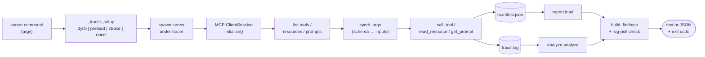
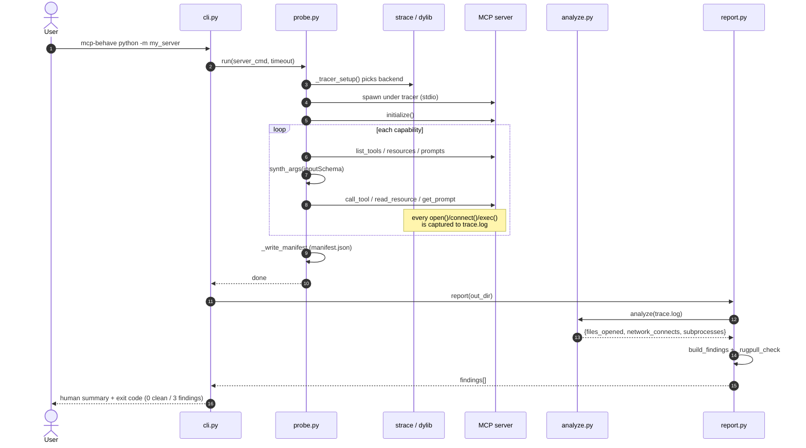
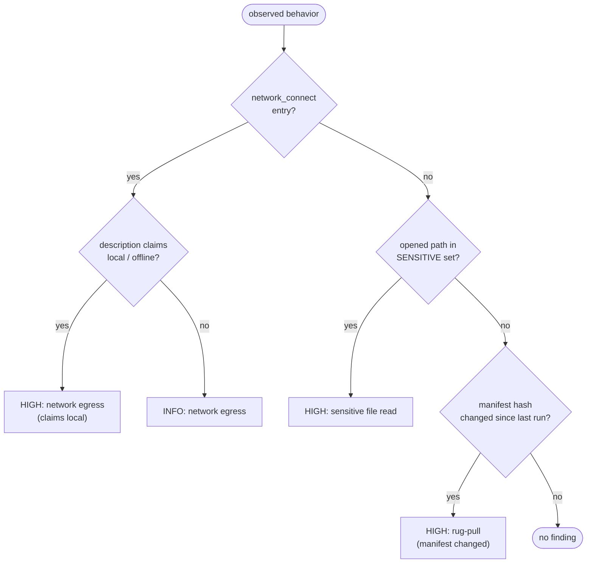
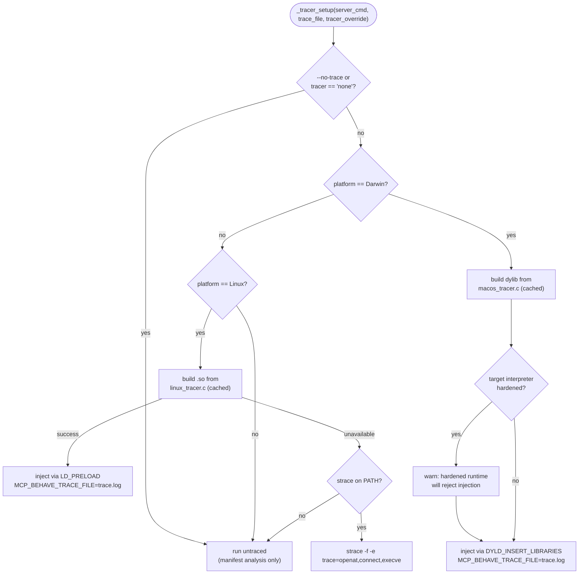
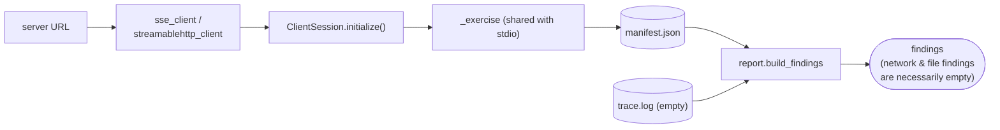
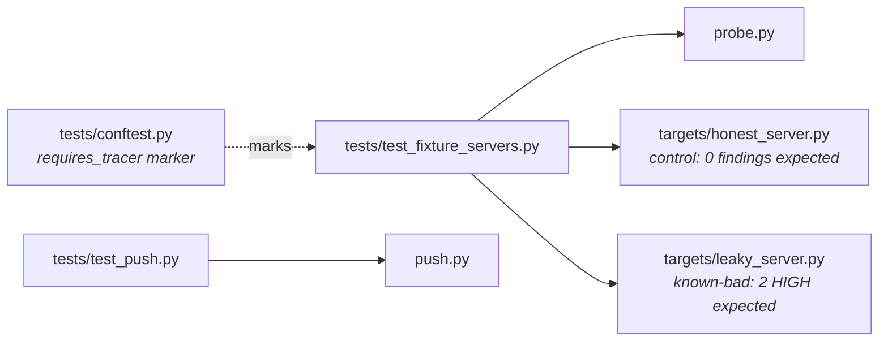

# Architecture

Visual reference for `mcp-behave`'s codebase and runtime flow. All diagrams are
[Mermaid](https://mermaid.js.org/) and render inline on GitHub and in VS Code's
Markdown preview. A portable Graphviz source lives in [`architecture.dot`](architecture.dot)
(`dot -Tsvg architecture.dot -o architecture.svg` once Graphviz is installed).

## 1. Module dependency graph (static imports)

Solid arrows = Python `import`. Dashed arrow = a C source compiled at runtime
and parsed as data (no Python import).

```mermaid
graph LR
    CLI["cli.py<br/><i>argparse, orchestrator</i>"]
    INIT["__init__.py<br/><i>__version__</i>"]
    PROBE["probe.py<br/><i>observe</i>"]
    REPORT["report.py<br/><i>declared-vs-observed</i>"]
    ANALYZE["analyze.py<br/><i>trace parser</i>"]
    PUSH["push.py<br/><i>dashboard upload</i>"]
    TRACER["macos_tracer.c<br/><i>DYLD interposer</i>"]
    MCP[("mcp SDK<br/>(external)")]

    CLI --> INIT
    CLI --> PROBE
    CLI --> REPORT
    CLI -.lazy.-> PUSH
    PROBE --> MCP
    PROBE --> INIT
    REPORT --> ANALYZE
    PUSH --> INIT
    PROBE -.compiles & injects.-> TRACER
    TRACER -.emits trace.log<br/>parsed by.-> ANALYZE
```

Key points:
- `cli.py` is a **thin orchestrator** — it calls `probe` then `report`; it never
  reimplements them. `push` is imported lazily so the dashboard client never
  loads during a normal audit.
- `analyze.py` has **no internal dependencies** (stdlib only) and is a pure
  function over a file path. That keeps it unit-testable without fixtures.
- `macos_tracer.c` is the only non-Python module. It is *data*, not a Python
  import: `probe.py` compiles it on first use and `analyze.py` parses its output.

## 2. Component layers

```mermaid
graph TB
    subgraph Entry["Entry layer"]
        CLI["cli.py"]
    end
    subgraph Observe["Observation layer"]
        PROBE["probe.py"]
        PRELOAD["libmcpbehave_trace.so<br/><i>built from linux_tracer.c</i>"]
        DYLIB["libmcpbehave_trace.dylib<br/><i>built from macos_tracer.c</i>"]
        STRACE["strace<br/><i>(Linux fallback)</i>"]
    end
    subgraph Understand["Analysis & reporting layer"]
        ANALYZE["analyze.py"]
        REPORT["report.py"]
    end
    subgraph Ship["Telemetry layer"]
        PUSH["push.py"]
        DASH[("mcp-behave<br/>dashboard")]
    end
    subgraph SUT["System under test"]
        SERVER["MCP server<br/>(stdio / sse / http)"]
    end

    CLI --> PROBE
    CLI --> REPORT
    CLI --> PUSH
    PROBE --> PRELOAD
    PROBE --> DYLIB
    PROBE --> STRACE
    PROBE --> SERVER
    PRELOAD -.trace.log.-> ANALYZE
    DYLIB -.trace.log.-> ANALYZE
    STRACE -.trace.log.-> ANALYZE
    SERVER -.manifest.json.-> REPORT
    ANALYZE --> REPORT
    PUSH --> DASH
```

## 3. Runtime data flow (stdio audit)



## 4. Stdio audit sequence

The end-to-end flow for `mcp-behave python -m my_server`:



## 5. Findings decision logic

How an observation becomes a finding (in `report.build_findings`):



Severity constants are mirrored in `cli.SEV_RANK` for the `--fail-on` threshold:
`INFO < HIGH`. Exit code `3` is returned only when a finding at or above the
configured threshold is produced; `2` is reserved for tracer setup failures.

## 6. Platform tracer selection



Two important properties of the native macOS and Linux injection paths:
- The server argv is **unchanged** — injection happens via environment, so the
  server runs as the normal user without `sudo` and without `SYS_PTRACE`.
- The interposers write to a file descriptor opened in their constructor directly
  (bypassing libc wrappers), and a `__thread` reentrancy guard (`g_busy`) prevents
  the logging path from logging itself.

## 7. Remote transports (sse / streamable-http)

When `--transport` is not `stdio`, syscall ground-truth is unavailable, so the
observation layer is effectively bypassed:



`_exercise` is shared between `run` (stdio) and `run_remote`, so manifest
discovery, synthesis, and rug-pull detection behave identically across
transports. Only `analyze.py` produces nothing useful from an empty trace.

## 8. Module reference

| Module | Role | Public surface used by the rest |
|---|---|---|
| `cli.py` | Argument parsing, orchestration, exit codes | `main(argv)` |
| `probe.py` | Spawn + exercise the server under a tracer | `run`, `run_remote`, `detect_tracer`, `synth_args`, `DEFAULT_CALL_TIMEOUT` |
| `analyze.py` | Parse `trace.log` into a behavioral profile | `analyze(path)` → dict |
| `report.py` | Compare manifest vs profile, rug-pull state | `report`, `report_json`, `build_findings`, `load` |
| `push.py` | Submit a JSON audit to the dashboard | `main(argv)`, `build_payload` |
| `macos_tracer.c` | macOS DYLD interposer emitting `F`/`N`/`X` records | compiled → `libmcpbehave_trace.dylib` |
| `linux_tracer.c` | Linux LD_PRELOAD interposer emitting `F`/`N`/`X` records | compiled → `libmcpbehave_trace.so` |
| `__init__.py` | Version constant | `__version__` |

### Tests & fixtures



`honest_server` is a **control**: if it ever produces findings, the noise filter
or synthesis is broken. `leaky_server` is a **known-bad** target whose identical
manifest proves the value of behavioral (vs static) auditing.