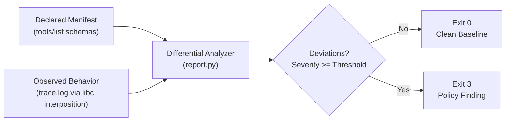
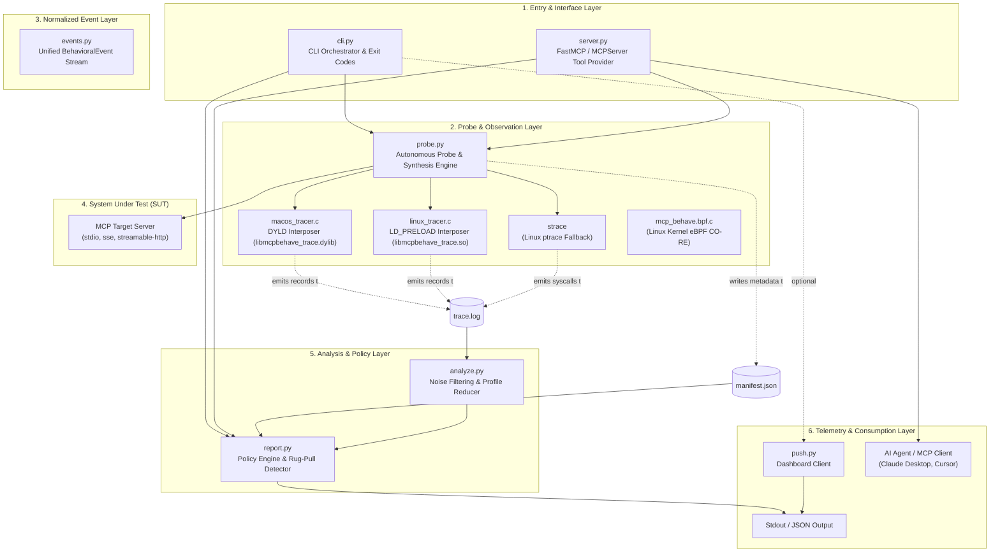
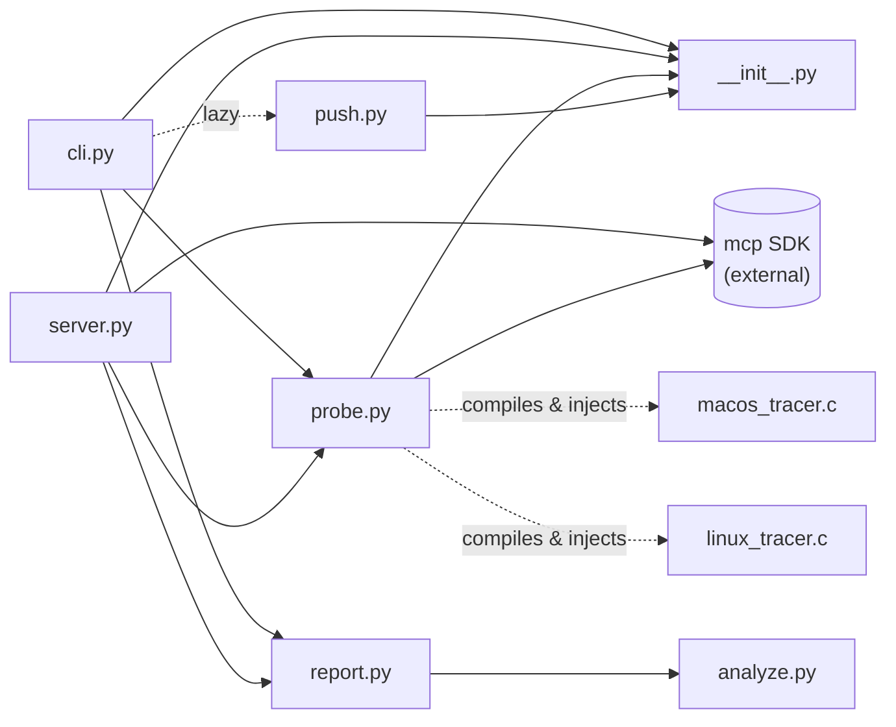
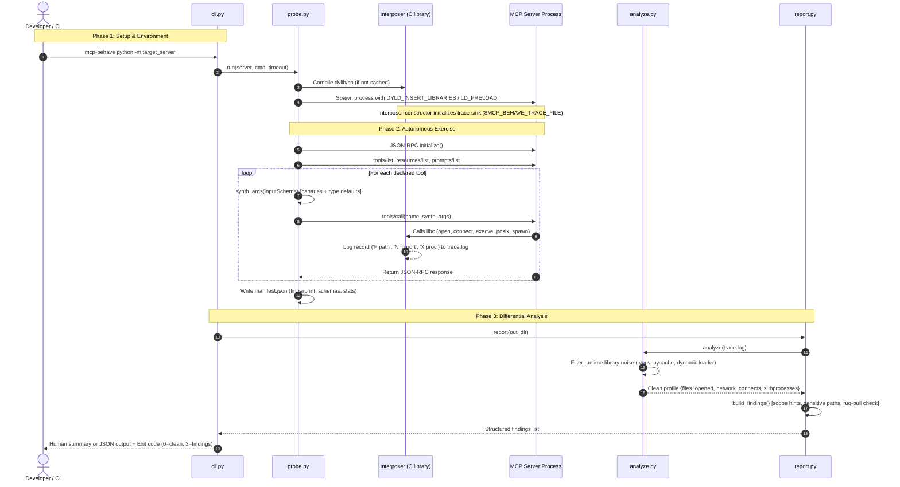
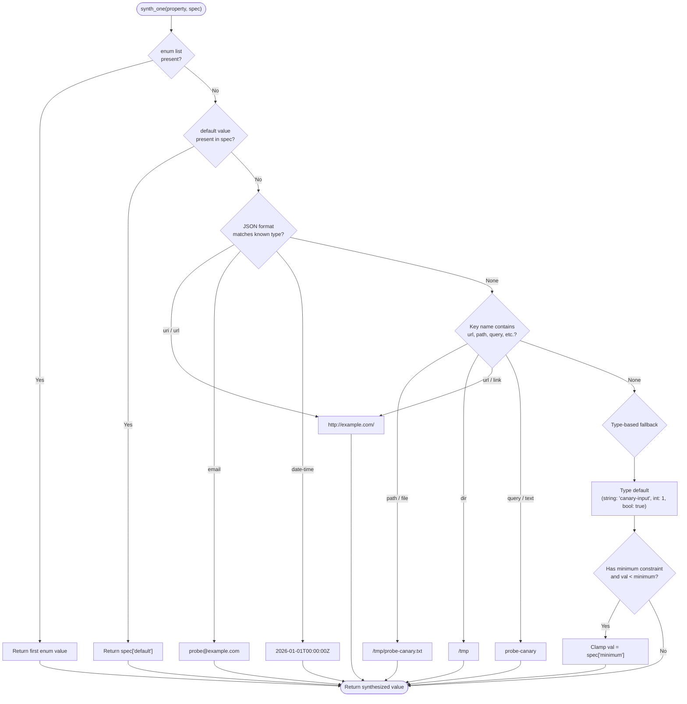
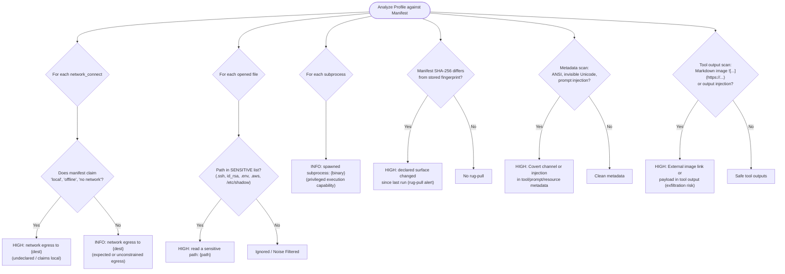
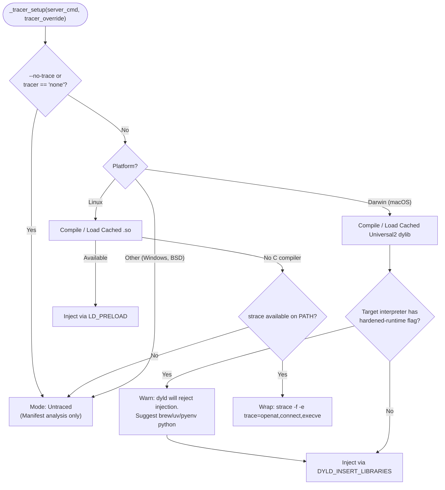

# Architecture of `mcp-behave`

A comprehensive technical reference for `mcp-behave`'s internal design, core concepts, and runtime mechanics.

---

## 1. Executive Overview & Mental Model

### The Problem: The MCP Privilege Gap

Model Context Protocol (MCP) servers run locally on a user's machine with the user's full operating system permissions. Traditional tool registries (e.g. Glama, PyPI, npm) verify servers using **static schema inspection**—validating JSON types, parameter descriptions, and docstrings.

However, static analysis cannot verify what a process actually executes at runtime. An MCP server advertising itself as a *"purely local markdown helper"* can silently open outbound network sockets, read `~/.ssh/id_rsa`, or spawn unconstrained subshells.

### The Solution: Differential Behavioral Auditing

`mcp-behave` treats an MCP server as a black-box executable under test. It spawns the server under a **user-space dynamic library interposer** (macOS `DYLD_INSERT_LIBRARIES` or Linux `LD_PRELOAD`), autonomously probes every declared capability with schema-valid canary arguments, records low-level operations (files opened, network sockets, subprocesses), and performs a **differential comparison**:

$$\text{Verdict} = \text{Observed Behavior} \setminus \text{Declared Surface}$$



---

## 2. Component Layers

`mcp-behave` is organized into five distinct, loosely coupled layers:



---

## 3. Module Dependency Graph (Static Architecture)

Solid lines represent Python imports. Dashed lines represent C source files compiled on-the-fly and inter-process data files.



### Architectural Properties
1. **Zero Internal Dependencies for `analyze.py`**: Stdlib only. It is a pure function over a log path, allowing comprehensive unit testing without mocks, fixtures, or running processes.
2. **`cli.py` as a Thin Coordinator**: Contains no business logic; it strictly handles `argparse`, invokes `probe.run()`, hands the output directory to `report.report()`, and maps findings to exit codes.
3. **Dual SDK Compatibility in `server.py`**: Gracefully falls back from `mcp.server.fastmcp.FastMCP` (SDK 1.x) to `mcp.server.mcpserver.MCPServer` (SDK 2.x), enabling `mcp-behave` to run as an MCP server in any environment.
4. **Compiled C Interposers as Data**: `macos_tracer.c` and `linux_tracer.c` are compiled on first run to a cached user directory (`~/.cache/mcp-behave/`) using standard system compilers (`clang` or `gcc`), requiring zero ahead-of-time C build configuration.

---

## 4. End-to-End Audit Sequence (stdio Transport)

When running `mcp-behave <server-command>`, the full lifecycle executes through five distinct phases:



---

## 5. Deep-Dive: Low-Level Systems Mechanics

### Dynamic Library Interposition (User-Space libc Tracing)

Rather than requiring root privileges or heavy kernel tracing up front, `mcp-behave` intercepts standard C library (libc) functions in user space via `DYLD_INSERT_LIBRARIES` on macOS and `LD_PRELOAD` on Linux:

```
┌────────────────────────────────────────────────────────┐
│ Target MCP Server (Python / Node / Ruby runtime)       │
└──────────────────────────┬─────────────────────────────┘
                           │ calls open(), openat(), connect(), sendto(), exec*()
                           ▼
┌────────────────────────────────────────────────────────┐
│ libmcpbehave_trace.dylib (macOS) / .so (Linux)         │
│   1. Re-entrancy guard check (g_busy)                  │
│   2. Format record:                                    │
│      - 'F <path>' (opened) / 'W <path>' (write/create) │
│      - 'N <ip> <port>' (TCP/UDP network egress)        │
│      - 'U <sun_path>' (UNIX domain socket)             │
│      - 'X <path>' (subprocess execution)               │
│   3. Write atomically to $MCP_BEHAVE_TRACE_FILE        │
│   4. Forward to real libc symbol                       │
└──────────────────────────┬─────────────────────────────┘
                           │ forwarded
                           ▼
┌────────────────────────────────────────────────────────┐
│ System libc / Kernel Syscall Boundary                  │
└────────────────────────────────────────────────────────┘
```

> [!NOTE]
> **Interposition Scope & Boundaries**: Because interposition hooks libc entry points, it comprehensively traces standard dynamic runtimes (Python, Node.js, Ruby, Bun). Statically compiled binaries (Go, musl Rust) and inline assembly syscalls bypass libc; for those targets, run with `--tracer strace` or the upcoming kernel-level eBPF backend.

#### Protocol Isolation Principle
Standard MCP stdio transport requires that **stdout strictly carry JSON-RPC protocol bytes**. A single stray byte or debug log sent to stdout corrupts JSON-RPC and crashes the connection. The tracer completely isolates its logging by:
1. Opening `$MCP_BEHAVE_TRACE_FILE` directly in its library constructor.
2. Writing all records to its private file descriptor (`g_trace_fd`).
3. Never writing to `stdout` or `stderr`.

#### The Subprocess Descriptor Invalidation Problem & Recovery
When Python executes a shell command (e.g. `subprocess.run(command, shell=True)`):
1. Python calls `_posixsubprocess.fork_exec()`.
2. Inside the forked child, Python closes all file descriptors above stderr (`close_open_fds()` / `close_fds=True`).
3. This action closes the tracer's inherited `g_trace_fd`.
4. When the child subsequently calls `execv` or `posix_spawn`, attempting to log `X /bin/sh` would fail silently with `EBADF` (Bad file descriptor).

**The Self-Healing Fix in `macos_tracer.c` and `linux_tracer.c`:**
The tracer's `emit()` function inspects the write return value:
```c
static void emit(const char *buf, size_t len) {
    if (g_trace_fd < 0) {
        const char *path = getenv("MCP_BEHAVE_TRACE_FILE");
        if (path && *path) g_trace_fd = open(path, O_WRONLY | O_APPEND | O_CREAT, 0600);
    }
    if (g_trace_fd < 0) return;
    ssize_t w = write(g_trace_fd, buf, len);
    if (w < 0) {
        /* If write fails (e.g. child closed descriptors before exec), atomically reopen */
        const char *path = getenv("MCP_BEHAVE_TRACE_FILE");
        if (path && *path) {
            int fd = open(path, O_WRONLY | O_APPEND | O_CREAT, 0600);
            if (fd >= 0) {
                (void)!write(fd, buf, len);
                g_trace_fd = fd;
            }
        }
    }
}
```
This guarantees reliable child subprocess tracing for dynamically linked runtimes.

---

## 6. Schema-Aware Canary Synthesis

A probe cannot observe tool behavior if the server rejects its arguments with schema validation errors. `probe.synth_args` implements a deterministic heuristic generator:



Canary inputs use reserved RFC ranges (RFC 2606 `example.com`, RFC 5737 `192.0.2.1`) so that probes never trigger live third-party services accidentally.

---

## 7. Policy Engine & Findings Logic

In `report.build_findings`, observed profiles are evaluated against declared metadata:



### Exit Codes & CI Integration
- **`0` Clean**: No findings at or above configured `--fail-on` threshold (default: `high`).
- **`2` Probe/Tracer Error**: Target command failed to launch, crashed on initialize, or rejected interposition.
- **`3` Policy Violation**: One or more findings generated at or above the threshold.

---

## 8. Platform Tracer Selection Matrix



---

## 9. Module & File Reference

| File | Primary Role | Key Exported APIs |
|---|---|---|
| [`cli.py`](src/mcp_behave/cli.py) | CLI argument parser, threshold evaluator, exit code handler | `main(argv)` |
| [`probe.py`](src/mcp_behave/probe.py) | Spawns server, exercises capabilities, synthesizes canary arguments | `run()`, `run_remote()`, `synth_args()`, `detect_tracer()` |
| [`analyze.py`](src/mcp_behave/analyze.py) | Parses raw `trace.log` into deduplicated, noise-filtered profile dict | `analyze(trace_path) -> dict` |
| [`report.py`](src/mcp_behave/report.py) | Compares declared vs. observed behavior, checks manifest rug-pulls | `report()`, `report_json()`, `build_findings()` |
| [`server.py`](src/mcp_behave/server.py) | Exposes `audit_server` and `inspect_manifest` as MCP tools over stdio/sse | `main()`, `audit_server()`, `inspect_manifest()` |
| [`push.py`](src/mcp_behave/push.py) | Telemetry client that uploads JSON audit results to a dashboard | `main(argv)`, `build_payload()` |
| [`macos_tracer.c`](src/mcp_behave/macos_tracer.c) | macOS C dynamic library interposing libc symbols via DYLD table | Interposes `open`, `openat`, `connect`, `execve`, `execv`, `posix_spawn` |
| [`linux_tracer.c`](src/mcp_behave/linux_tracer.c) | Linux C shared library interposing libc symbols via `dlsym(RTLD_NEXT)` | Interposes `open`, `openat`, `connect`, `execve`, `execv`, `posix_spawn` |

---

## 10. Summary: The Security Verification Paradigm

| Metric | Traditional Static Scanners | `mcp-behave` Runtime Auditor |
|---|---|---|
| **Inspection Target** | Tool docstrings, parameter types, AST | Operating system calls & runtime state |
| **Network Visibility** | None (cannot detect sockets) | Intercepts `connect()` destinations |
| **Filesystem Safety** | Relies on path string conventions | Observes actual libc `open()` and `openat()` |
| **Execution Sandboxing**| Blind to `subprocess` / `shell=True` | Intercepts `execve`, `execv`, `posix_spawn` |
| **Identity Verification** | Static version numbers | Cryptographic manifest SHA-256 fingerprinting |
| **Execution Context** | Offline / CI linting | Live sandbox execution with canary probing |
