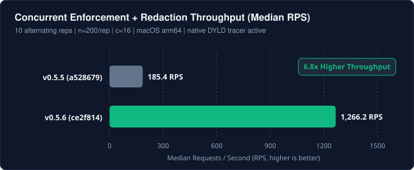
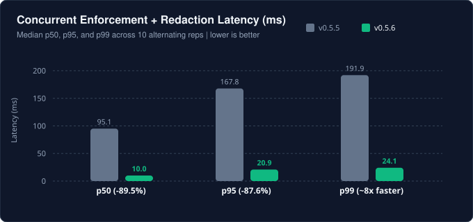
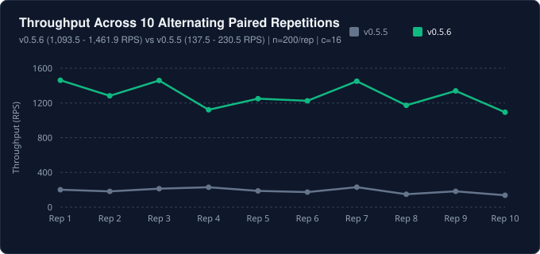
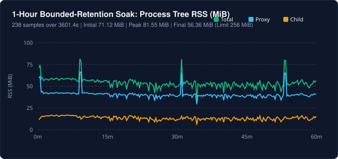
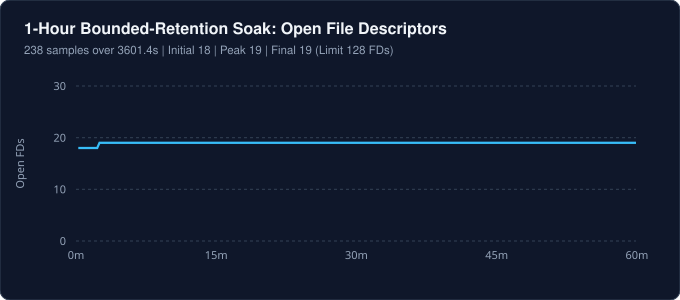
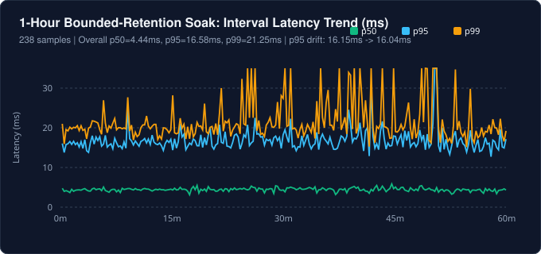
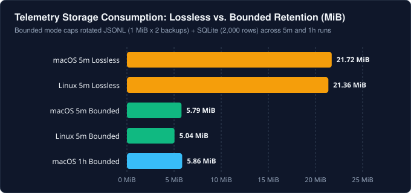

# MCP-Behave Benchmarks & Validation Evidence (BENCHMARK.md)

> **Authoritative evaluation hub for `mcp-behave` v0.5.6 runtime performance, endurance stability, cross-platform validation, and historical security-detection corpora.**

---

## 1. Latest Release Performance Summary (v0.5.6)

- **Integrated Release Commit**: `cb9237578c453069f0069e47ee2f60e8d13ff644`
- **Production `src/` Tree**: `2c9a19786550e06f7541cd965626673c70850f3b`

| Validation Dimension | Measured Result (v0.5.6) | Qualification / Scope |
| --- | --- | --- |
| **Paired Concurrent `--enforce --redact`** | **1,266.2 RPS** median (`6.8×` vs `v0.5.5`) | 10 alternating reps, `n=200`, `c=16`, macOS arm64, `macos_dyld` active |
| **Median `p50` / `p95` / `p99` Latency** | **10.003 / 20.851 / 24.075 ms** | `-89.5%` p50, `-87.6%` p95, `~8×` p99 vs `v0.5.5` on same workload |
| **1-Hour Bounded-Retention Soak** | **101,052 ok / 0 fail / 0 timeouts** | `2,833` secrets verified, `0` leaks, `567/567` disconnect checks; completeness `UNVERIFIED` (pruned) |
| **5-Minute Lossless Soaks** | **VERIFIED** exact identity reconciliation | Both macOS arm64 (`8,490` ok) and Linux aarch64 (`8,387` ok), `0` missing/dup/unexpected |
| **Regression Suites** | **467 passed** (macOS), **464 passed / 3 skipped** (Linux) | Plus **23/23** reviewer-authored regression and corrective probe tests (rerun locally) |

---

## 2. Paired v0.5.5 vs. v0.5.6 Comparison

Workload: concurrent `--enforce --redact` over stdio (`mock_mcp_server.py`, 200 mixed small/medium/large requests per repetition, concurrency `16`, `seed=42`), Python `3.12.7` (`hardened=False`, native `macos_dyld` tracer active), 10 alternating repetitions per version in isolated detached Git worktrees (`v0.5.5` at `a528679` vs `v0.5.6` at `ce2f814`).

| Metric | v0.5.5 (`a528679`) | v0.5.6 (`ce2f814`) | Improvement |
| --- | ---: | ---: | --- |
| **Median Throughput** | 185.4 RPS | **1,266.2 RPS** | **6.8× higher** (range `1,093.5–1,461.9` vs `137.5–230.5`) |
| **Median `p50` Latency** | 95.062 ms | **10.003 ms** | **89.5% reduction** |
| **Median `p95` Latency** | 167.835 ms | **20.851 ms** | **87.6% reduction** |
| **Median `p99` Latency** | 191.919 ms | **24.075 ms** | **~8× faster** (`7.97×`) |

*Scope note: These figures apply specifically to concurrent inline enforcement and redaction under the tested stdio workload and do not generalize automatically to unrelated workloads, remote HTTP transports, or other operating systems.*







---

## 3. Endurance and Resource Stability (1-Hour Soak)

Executed on macOS arm64 (`25.6.0`, Python `3.12.7`, `macos_dyld` tracer `sha256=75fdf9c8...`) in `enforce_redact` mode (`rate=25`, `concurrency=16`, `large_bytes=131072`, `max_jsonl_bytes=1 MiB`, `max_jsonl_backups=2`, `max_sqlite_events=2000`, `retention_interval=10s`, RSS cap `256 MiB`, FD cap `128`).

| Metric | Measured Value |
| --- | --- |
| **Duration / Requests** | `3,601.43 s` — **101,052** succeeded, **0** failed, **0** timed out (`28.06 RPS`) |
| **Secret Verification / Leaks** | **2,833** verified redactions, **0** secret leaks |
| **Disconnect Checks** | **567 / 567** passed (expected crash exit code `42`, zero orphans) |
| **Overall Latency (`p50` / `p95` / `p99`)** | `4.4366 ms` / `16.5788 ms` / `21.2469 ms` (`p95` drift: `16.146 -> 16.040 ms`) |
| **Process Tree RSS** | Initial `71.12 MiB`, Peak `81.55 MiB`, Final `56.36 MiB` (`-14.76 MiB`) |
| **Open File Descriptors** | `18 -> 19` (Peak `19`) |
| **Final Storage** | `5,999.6 KiB` (`~5.86 MiB`: `sqlite_total=2,000`, `rotated_jsonl=2`) |
| **Graceful Shutdown** | `0.108 s` (`exit=0`, `orphans_after_shutdown=False`) |
| **Telemetry Completeness** | **`UNVERIFIED`** (`validation_profile="bounded"`, intentional pruning/rotation active, `0` drops) |

> **Important**: This was a **bounded-retention** endurance test. Full-run telemetry completeness is explicitly **`UNVERIFIED`** because older JSONL archives and SQLite rows were intentionally pruned during the hour; it must not be cited as proof of complete lossless observation.







---

## 4. Lossless vs. Bounded-Retention Validation (5-Minute Soaks)

| Run | Profile | Tracer | Requests (ok/fail/to) | Secrets Verified / Leaked | Storage | Completeness Status |
| --- | --- | --- | --- | --- | ---: | --- |
| **macOS 5m Lossless** | `lossless` | `macos_dyld` | `8,490 / 0 / 0` | `238 / 0` | `22,242.4 KiB` | **`VERIFIED`** (`0` missing/dup/unexpected) |
| **Linux 5m Lossless** | `lossless` | `linux_ld_preload` | `8,387 / 0 / 0` | `235 / 0` | `21,875.3 KiB` | **`VERIFIED`** (`0` missing/dup/unexpected) |
| **macOS 5m Bounded** | `bounded` | `macos_dyld` | `8,460 / 0 / 0` | `237 / 0` | `5,926.8 KiB` | **`UNVERIFIED`** (`0` drops, `sqlite=2,000`) |
| **Linux 5m Bounded** | `bounded` | `linux_ld_preload` | `8,517 / 0 / 0` | `239 / 0` | `5,163.8 KiB` | **`UNVERIFIED`** (`0` drops, `sqlite=2,000`) |



---

## 5. Cross-Platform Validation

- **macOS (`arm64`, macOS `25.6.0`, Python `3.12.3` / `3.12.7`)**:
  - **467 / 467** product tests passed (`tests/`).
  - **23 / 23** reviewer-authored regression and corrective probe tests passed when rerun locally (`report/MCP-2-review/test_review_regressions.py` + `test_final_identity_and_wording.py`).
  - Native `DYLD_INSERT_LIBRARIES` tracer (`libmcpbehave_trace.dylib`, `sha256=75fdf9c8...`) verified active on unhardened Python (`3.12.7`).
  - 5-minute lossless (`VERIFIED`) and 5-minute + 1-hour bounded (`UNVERIFIED`) soaks passed.
- **Linux (`aarch64` Docker `python:3.12-slim`, kernel `7.0.14-orbstack`)**:
  - **464 passed, 3 skipped** (the 3 skipped tests are macOS-specific).
  - Native `LD_PRELOAD` tracer (`libmcpbehave_trace.so`, `sha256=6ca109bd...`) compiled and verified via live child handshake (`T <pid> READY`).
  - 5-minute lossless (`VERIFIED`) and 5-minute bounded (`UNVERIFIED`) soaks passed.
- **Untested platforms**: Bare-metal `x86_64` Linux and native Windows were not executed in this validation pass.

---

## 6. Security Detection Benchmarks & External Corpora

In addition to `wrap` runtime validation, the repository maintains corpus and external benchmark evaluations for `mcp-behave` auditing (see individual reports for tested versions and conditions):

| Benchmark Suite | Focus Area | Reported Result | Reference |
| --- | --- | --- | --- |
| **Twin-Server Corpus** *(v0.4.x)* | Malicious server behaviors (`bench/run.py --rounds 3`) | **90.0% Recall, 0.0% FPR, 6/7 Pair Separation** | Section 9 (`bench/run.py`) |
| **CrossMCP-Bench** | Multi-server authorization & cross-tool exfiltration | **100.0% Prevention, 0.0% FPR** | [`docs/benchmarks/crossmcp_bench_report.md`](docs/benchmarks/crossmcp_bench_report.md) |
| **Pluto MCP Visibility** | Syscall observation coverage across 12 capability classes | **100.0% Detection (12/12)** | [`docs/benchmarks/pluto_visibility_bench.md`](docs/benchmarks/pluto_visibility_bench.md) |
| **MCP-GuardBench** | Tool argument vulnerability & prompt injection defense | **100.0% Detection, 0.0% FPR** | [`docs/benchmarks/guardbench_report.md`](docs/benchmarks/guardbench_report.md) |
| **Official Reference Servers** | 7 reference servers + 15 adversarial scenarios | Published empirical audit | [`docs/benchmarks/official_servers_audit.md`](docs/benchmarks/official_servers_audit.md) |

---

## 7. Reproduction Methodology

> **Important provenance fix**: Earlier 5-repetition comparison runs (`wrap_v055_5rep.json` / `wrap_v056_5rep.json`) were **invalidated and excluded** from release performance claims because `benchmarks/bench_wrap.py` overwrote the caller's `PYTHONPATH` with its own `SRC_DIR`, causing both runs to import `v0.5.6`.

Use the standalone provenance-verified runner [`benchmarks/run_paired_comparison.py`](benchmarks/run_paired_comparison.py), which:
1. Creates isolated detached Git worktrees for `--baseline-ref` and `--candidate-ref`.
2. Verifies inside fresh subprocesses that `mcp_behave.enforce.__file__` resolves strictly inside the intended worktree (failing immediately on mismatch).
3. Records `enforce.py` and `protocol.py` SHA-256 digests and native tracer eligibility.
4. Alternates execution order across repetitions using identical workloads and saves both per-repetition and aggregate results.

```sh
# 1. Paired v0.5.5 vs v0.5.6 concurrent --enforce --redact comparison
.venv/bin/python benchmarks/run_paired_comparison.py \
  --python .venv/bin/python \
  --baseline-ref v0.5.5 \
  --candidate-ref cb9237578c453069f0069e47ee2f60e8d13ff644 \
  --repetitions 10 --conc-count 200 --concurrency 16 --seed 42 \
  --json-out benchmarks/results/v0.5.6/paired_conc_redact_10rep.json

# 2. Lossless 5-minute soak (exact identity reconciliation)
PYTHONPATH=src:. .venv/bin/python benchmarks/soak_wrap.py \
  --validation-profile lossless --duration 300 --mode enforce_redact \
  --rate 25 --concurrency 16 --large-bytes 131072 --seed 42 \
  --max-jsonl-bytes 0 --max-jsonl-backups 0 --max-sqlite-events 0 --retention-interval 0 \
  --max-rss-mib 256 --max-fds 128

# 3. Bounded-retention 1-hour endurance soak
PYTHONPATH=src:. .venv/bin/python benchmarks/soak_wrap.py \
  --validation-profile bounded --duration 3600 --sample-interval 15 --mode enforce_redact \
  --rate 25 --concurrency 16 --large-bytes 131072 --seed 42 \
  --max-jsonl-bytes 1048576 --max-jsonl-backups 2 --max-sqlite-events 2000 --retention-interval 10 \
  --max-rss-mib 256 --max-fds 128
```

---

## 8. Known Limitations

- **PID-only identity assurance**: `TracerServer` tracks PIDs best-effort (`best_effort_pid_only`) and cannot rule out OS PID reuse after capacity eviction or delayed `READY` arrival.
- **Session-level attribution uncertainty**: Unparseable protocol frames, monitor queue drops, or evicted in-flight calls degrade attribution to `correlated` until a trusted lifecycle resynchronization boundary.
- **SQLite logical row bounds**: `--max-sqlite-events` bounds logical row count (`DELETE`), not physical disk file size without `VACUUM`; WAL is truncated when exceeding `16 MiB`.
- **Bounded-retention completeness**: Full-run observation completeness is explicitly `UNVERIFIED` under `--validation-profile bounded` when pruning/rotation occurs.
- **Platform coverage**: Linux validation ran on `aarch64` Docker (`python:3.12-slim`), not bare-metal `x86_64` Linux or native Windows.
- **Point-in-time orphan detection**: Post-shutdown orphan checks use point-in-time `ps` snapshots.
- **Dynamic libc interposition boundaries**: Static binaries, raw `syscall` instructions, and in-band payload tampering (`postmark_inband_bcc`) remain documented boundaries of libc-level interposition.

---

## 9. Historical Benchmark Archive

The evaluations below were recorded on earlier `v0.4.x` releases and are preserved for historical reference:

- **Twin-Server Corpus (`bench/corpus/`, 17 servers across 7 domain pairs, v0.4.x)**: `mcp-behave` with `--probe-rounds 3` achieved **100.0% precision**, **90.0% recall (9/10)**, **0.0% FPR (0/7)**, and **6/7 (85.7%)** twin-pair separation (`postmark_inband_bcc` documented as a transport-matching miss; `deadbugz_delayed` caught with 3 rounds). Reproducible via `python3 bench/run.py --rounds 3`.
- **External Corpora**: [`docs/benchmarks/crossmcp_bench_report.md`](docs/benchmarks/crossmcp_bench_report.md), [`docs/benchmarks/pluto_visibility_bench.md`](docs/benchmarks/pluto_visibility_bench.md), [`docs/benchmarks/guardbench_report.md`](docs/benchmarks/guardbench_report.md), [`docs/benchmarks/official_servers_audit.md`](docs/benchmarks/official_servers_audit.md).
