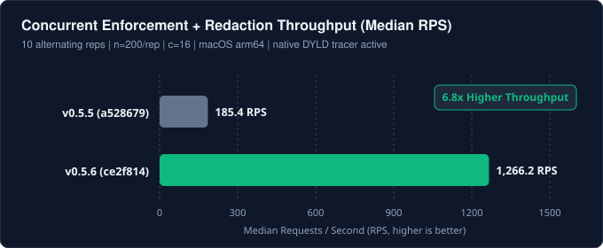
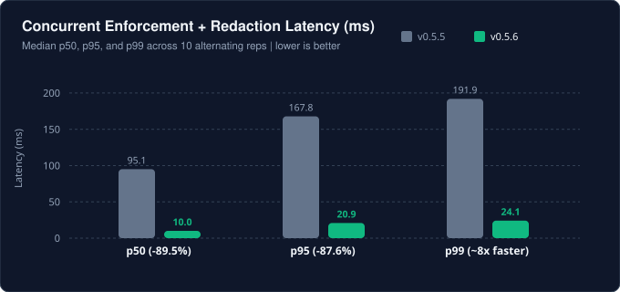
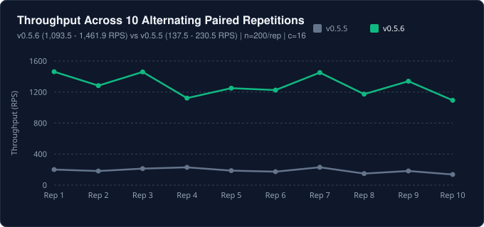
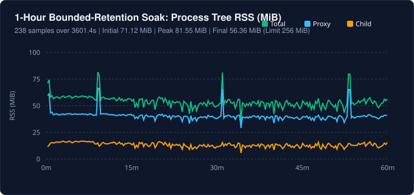
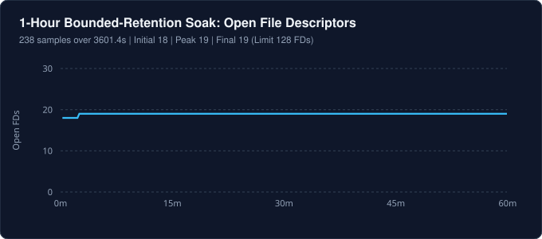
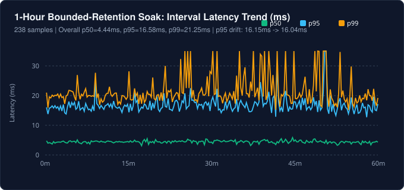
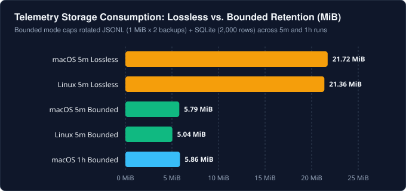

# mcp-behave v0.5.6 Benchmark & Operational Validation Evidence

Integrated release commit: `cb9237578c453069f0069e47ee2f60e8d13ff644` (operationally validated production `src/` tree `2c9a19786550e06f7541cd965626673c70850f3b`, candidate `08fefb97782f6691bb157d8bdb7500ea234481a3`).

## Visual Overview















## Artifact Inventory

| File | Description | Platform / Tracer | Outcome |
| --- | --- | --- | --- |
| `paired_conc_redact_10rep.json` | 10-repetition alternating comparison (`v0.5.5` vs `v0.5.6`, concurrent `--enforce --redact`, `n=200`, `c=16`) | macOS arm64 / Python 3.12.7 (`macos_dyld` active) | `v0.5.6`: `1,266.2` med RPS vs `185.4` (`6.8×`); `p50=10.003ms` vs `95.062ms` (`-89.5%`); `p95=20.851ms` vs `167.835ms` (`-87.6%`); `p99=24.075ms` vs `191.919ms` (`~8×`) |
| `soak_macos_lossless_5m.json` | 5-minute lossless observation soak (`enforce_redact`, `rate=25`, `c=16`, `128 KiB`) | macOS arm64 / `macos_dyld` (`sha256=75fdf9c8...`) | `PASS`, `8,490` ok, `0` fail/timeout, `completeness_status=VERIFIED`, `0` missing/dup/unexpected |
| `soak_macos_bounded_5m.json` | 5-minute bounded-storage soak (`max_jsonl=1 MiB`, `backups=2`, `max_sqlite=2000`, `ret=10s`) | macOS arm64 / `macos_dyld` (`sha256=75fdf9c8...`) | `PASS`, `8,460` ok, `0` fail/timeout, `5,926.8 KiB`, `sqlite=2,000`, `completeness_status=UNVERIFIED` |
| `soak_linux_lossless_5m.json` | 5-minute Linux lossless observation soak | Linux aarch64 Docker / `linux_ld_preload` (`sha256=6ca109bd...`) | `PASS`, `8,387` ok, `0` fail/timeout, `235` secrets verified, `0` leaks, `completeness_status=VERIFIED` |
| `soak_linux_bounded_5m.json` | 5-minute Linux bounded-storage soak | Linux aarch64 Docker / `linux_ld_preload` (`sha256=6ca109bd...`) | `PASS`, `8,517` ok, `0` fail/timeout, `239` secrets verified, `0` leaks, `5,163.8 KiB`, `completeness_status=UNVERIFIED` |
| `soak_macos_bounded_1h.json` | 1-hour bounded-retention endurance soak | macOS arm64 / `macos_dyld` (`sha256=75fdf9c8...`) | `PASS`, `101,052` ok, `0` fail/timeout, `2,833` secrets verified, `0` leaks, `567/567` disconnect checks, peak RSS `81.55 MiB`, FDs `18 -> 19`, `5.86 MiB`, `completeness_status=UNVERIFIED` |

> **Excluded invalid 5-repetition comparison**: Earlier 5-repetition comparison runs (`wrap_v055_5rep.json` / `wrap_v056_5rep.json`) are excluded from performance claims because `benchmarks/bench_wrap.py` overwrote the caller's `PYTHONPATH` with its own `SRC_DIR`, causing both runs to import `v0.5.6`. The verified 10-repetition paired comparison (`paired_conc_redact_10rep.json`) is the authoritative comparative evidence.

## Accepted Limitations

- **PID-only identity assurance**: `TracerServer` tracks PIDs best-effort (`identity_assurance="best_effort_pid_only"`) and cannot rule out OS PID reuse after capacity eviction or delayed `READY` arrival.
- **Session-level attribution uncertainty**: Unparseable protocol messages, monitor queue drops, or evicted in-flight calls degrade attribution to `correlated` with `attribution_incomplete=True` until a trusted lifecycle resynchronization boundary.
- **SQLite logical row bounds**: `--max-sqlite-events` bounds logical row count (`DELETE`), not physical disk file size without `VACUUM`; WAL is truncated when exceeding `16 MiB`.
- **Bounded-retention completeness**: Under `--validation-profile bounded`, full-run observation completeness is explicitly reported as `UNVERIFIED` when pruning/rotation occurs.
- **Linux environment**: Linux validation ran in `aarch64` Docker (`python:3.12-slim`, `7.0.14-orbstack`); `x86_64` bare-metal Linux and native Windows were not tested.
- **Point-in-time orphan checks**: Post-shutdown orphan detection uses point-in-time `ps` snapshots.

## Reproduction Instructions

1. **Paired `v0.5.5` vs `v0.5.6` concurrent `--enforce --redact` comparison** (uses isolated Git worktrees, verifies `mcp_behave.enforce.__file__` inside fresh subprocesses, records source SHA-256 digests and tracer eligibility, and alternates version order):
   ```sh
   .venv/bin/python benchmarks/run_paired_comparison.py \
     --python .venv/bin/python \
     --baseline-ref v0.5.5 \
     --candidate-ref cb9237578c453069f0069e47ee2f60e8d13ff644 \
     --repetitions 10 --conc-count 200 --concurrency 16 --seed 42 \
     --json-out benchmarks/results/v0.5.6/paired_conc_redact_10rep.json
   ```

2. **Lossless 5-minute soak** (exact identity reconciliation in JSONL and SQLite):
   ```sh
   PYTHONPATH=src:. .venv/bin/python benchmarks/soak_wrap.py \
     --validation-profile lossless --duration 300 --mode enforce_redact \
     --rate 25 --concurrency 16 --large-bytes 131072 --seed 42 \
     --max-jsonl-bytes 0 --max-jsonl-backups 0 --max-sqlite-events 0 --retention-interval 0 \
     --max-rss-mib 256 --max-fds 128
   ```

3. **Bounded-retention 1-hour endurance soak** (resource stability and storage bounds; completeness `UNVERIFIED` due to intentional pruning):
   ```sh
   PYTHONPATH=src:. .venv/bin/python benchmarks/soak_wrap.py \
     --validation-profile bounded --duration 3600 --sample-interval 15 --mode enforce_redact \
     --rate 25 --concurrency 16 --large-bytes 131072 --seed 42 \
     --max-jsonl-bytes 1048576 --max-jsonl-backups 2 --max-sqlite-events 2000 --retention-interval 10 \
     --max-rss-mib 256 --max-fds 128
   ```
