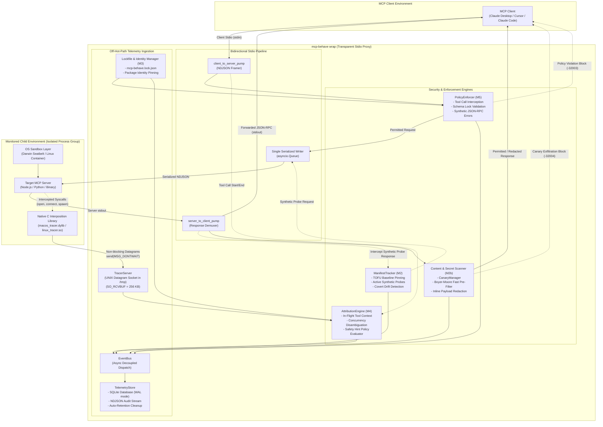
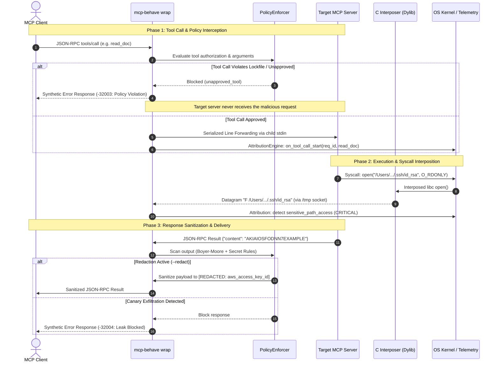

# `mcp-behave` System Architecture

This document illustrates the end-to-end architecture of **`mcp-behave wrap`**, demonstrating how it acts as an inline, zero-overhead, transparent security barrier between an MCP client and an untrusted MCP server.

---

## 1. High-Level System Architecture

---

## 2. Request & Response Lifecycle Sequence

---

## 3. Evidence Tier Classification Model

```mermaid
graph TD
    classDef observed fill:#1b5e20,stroke:#4caf50,color:#fff;
    classDef correlated fill:#e65100,stroke:#ff9800,color:#fff;
    classDef structural fill:#0d47a1,stroke:#2196f3,color:#fff;
    classDef heuristic fill:#4a148c,stroke:#ab47bc,color:#fff;

    Root["mcp-behave Evidence Tiers"] --> TierObserved["1. OBSERVED\n(Direct Kernel / Protocol Ground Truth)"]:::observed
    Root --> TierCorrelated["2. CORRELATED\n(Disambiguated Multi-Source Events)"]:::correlated
    Root --> TierStructural["3. STRUCTURAL\n(Static Schema & Package AST Analysis)"]:::structural
    Root --> TierHeuristic["4. HEURISTIC\n(Statistical & Pattern Matching)"]:::heuristic

    TierObserved --> O1["Interposed Syscall (Single In-Flight Tool)"]
    TierObserved --> O2["Cryptographic Package Hash & Signature"]
    TierObserved --> O3["Deterministic Protocol Framing"]

    TierCorrelated --> C1["Syscall during Concurrent Tool Calls"]
    TierCorrelated --> C2["Background Server Thread Activity"]

    TierStructural --> S1["Schema Drift & Type Constraint Relaxation"]
    TierStructural --> S2["Annotation Weakening (readOnly -> false)"]

    TierHeuristic --> H1["Secret Pattern Detection (High Entropy)"]
    TierHeuristic --> H2["Prompt Injection Keyword Scoring"]
```

