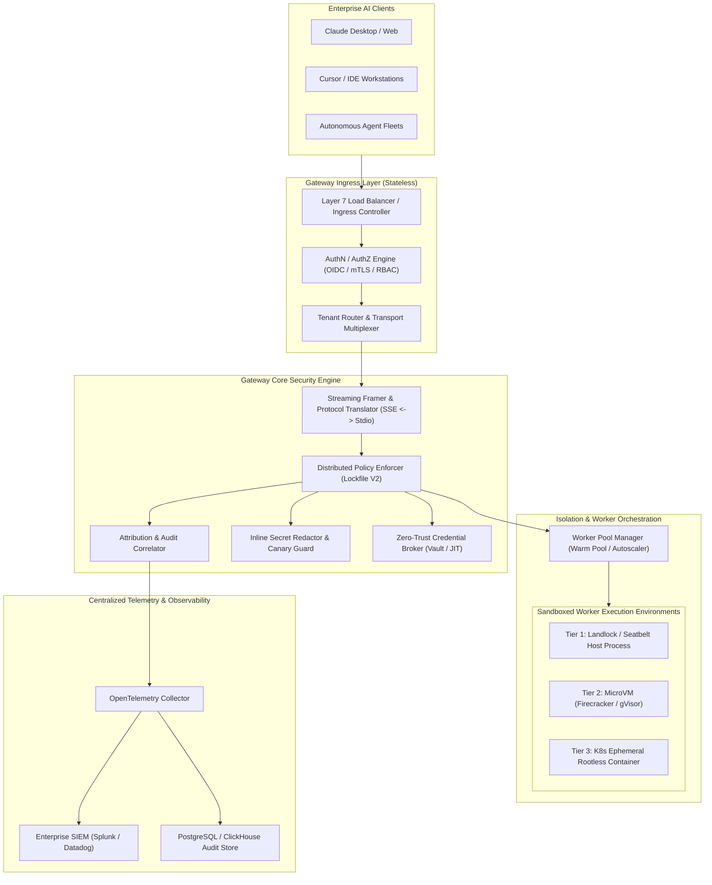
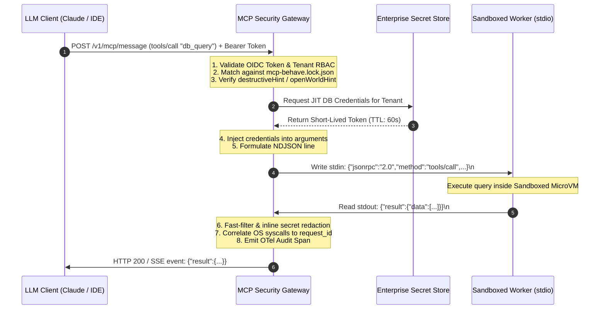
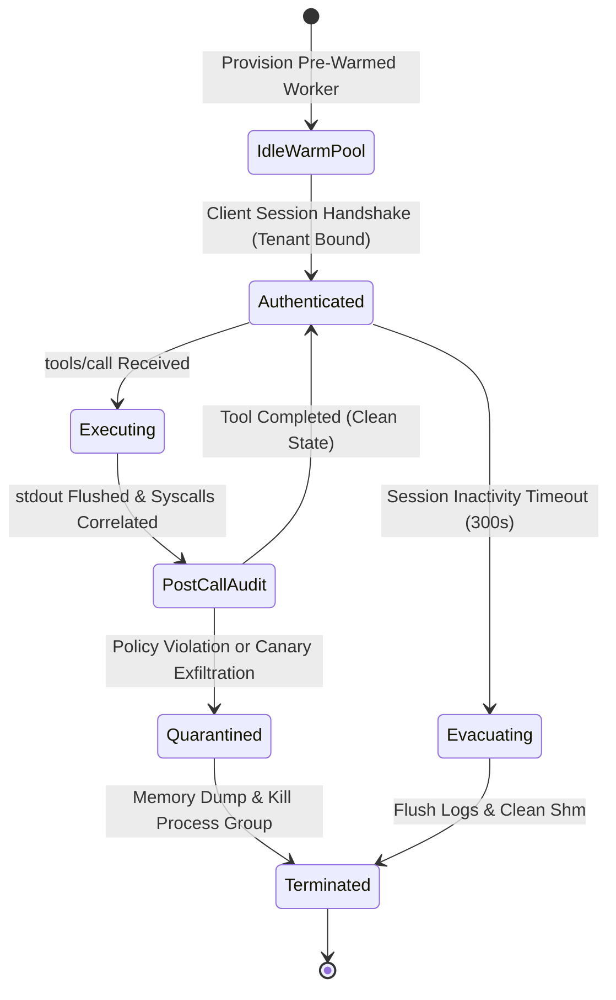
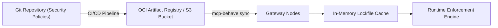
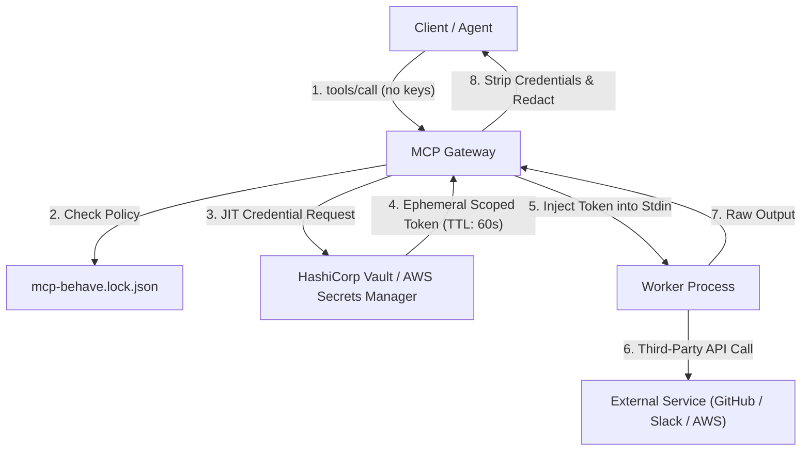

# Enterprise MCP Security Gateway Architecture

**Status**: APPROVED DESIGN SPECIFICATION  
**Author**: Antigravity & the `mcp-behave` Core Architecture Team  
**Milestone**: Milestone 7 (M7)  
**Date**: November 21, 2026  
**Document Version**: 1.0.0  

---

## 1. Executive Summary & Vision

The Model Context Protocol (MCP) standardizes integration between Large Language Model (LLM) clients and local or remote resources, tools, and prompts. While `mcp-behave wrap` establishes a robust local defense-in-depth model (incorporating streaming NDJSON framing, active re-verification, lockfile pinning, Darwin Seatbelt kernel sandboxing, in-flight attribution, and inline redaction), modern enterprise deployments require extending these guarantees beyond single developer workstations.

Enterprise environments introduce distinct distributed challenges:
1. **Network Topologies & Heterogeneous Transports**: Clients communicate over HTTP/SSE, WebSockets, or gRPC across corporate networks, while backends may be containerized microservices or legacy stdio binaries.
2. **Multi-Tenancy & Zero Trust**: Multiple users, automated agent pipelines, and departments share tool clusters without cross-tenant data contamination or privilege escalation.
3. **Decoupled Credential Management**: LLM clients must never possess direct third-party API credentials, and untrusted tool processes must never access ambient host or cloud credentials.
4. **Fleet-Wide Policy Governance**: Security operations teams need centralized lockfile registries (`mcp-behave.lock.json`), continuous drift auditing, and streaming SIEM telemetry into enterprise platforms (Splunk, Datadog, OpenTelemetry).

The **Enterprise MCP Security Gateway** is an intelligent, high-throughput, multi-tenant proxy and orchestration control plane. It acts as the single security perimeter governing all MCP interactions across an organization.

---

## 2. Gateway Architecture & Topology

### 2.1. Ingress Transports & Protocol Multiplexing

The Gateway provides unified ingress endpoints supporting three transport paradigms:

1. **Server-Sent Events (SSE) & HTTP Post**:
   - `GET /v1/mcp/sse`: Establishes downstream event stream to client. Emits `endpoint` URI for incoming client JSON-RPC messages.
   - `POST /v1/mcp/message?sessionId=<session>`: Receives incoming JSON-RPC calls from clients.
2. **Stateful WebSockets**:
   - `WSS /v1/mcp/ws`: Full-duplex JSON-RPC transport for latency-sensitive autonomous agent loops and streaming tool responses.
3. **Local Unix Domain Socket (UDS) / Stdio Bridge**:
   - `/run/mcp-gateway/gateway.sock`: Local high-speed socket bridge for developer desktop integration without public network exposure.

### 2.2. Bi-Directional Transport Translation

Local MCP tools communicate over stdio NDJSON (`\n`-delimited lines). The Gateway features a high-throughput **Transport Translation Pipeline**:

- **Downstream (Client $\to$ Gateway $\to$ Worker)**:
  - Client sends JSON-RPC request over HTTP POST or WebSocket.
  - Gateway validates tenant authorization, assigns distributed span IDs (`traceparent`), applies request enforcement rules, injects brokered credentials, and writes formatted NDJSON lines to the worker's stdin pipe.
- **Upstream (Worker $\to$ Gateway $\to$ Client)**:
  - Worker writes NDJSON response to stdout.
  - Gateway's `StreamingFramer` frames lines up to 16 MB with zero buffer overflows.
  - Gateway executes canary check and inline payload redaction.
  - Emits JSON-RPC payload as an SSE `message` event or WebSocket frame.

---

## 3. Multi-Tenant Isolation & Worker Lifecycle

### 3.1. Tiered Worker Execution Matrix

To balance high-density developer tooling with untrusted third-party code execution, the Gateway implements a three-tier isolation hierarchy:

| Tier | Isolation Backend | Startup Latency | Security Boundary | Target Workloads |
| :--- | :--- | :--- | :--- | :--- |
| **Tier 1 (Process)** | Linux Landlock + cgroups v2 / macOS Seatbelt | $< 15\text{ ms}$ | Kernel namespace & syscall restriction | Trusted in-house internal tools; read-only utility servers. |
| **Tier 2 (MicroVM)** | Firecracker / gVisor (`runsc`) | $100 - 250\text{ ms}$ | Hardware virtualization (KVM) or user-space kernel | Community MCP packages (`npx`, `uvx`); untrusted third-party servers. |
| **Tier 3 (Container)** | Kubernetes Rootless Pods / Podman | $500\text{ ms} - 1.5\text{ s}$ | Multi-container pod with network policy isolation | Heavy persistent services, headless browser automation, Docker-in-Docker tools. |

### 3.2. Worker Lifecycle & Warm-Pool Management

1. **Pre-Warmed Pool**: The Gateway maintains a pool of pre-forked, uninitialized worker processes/microVMs per tenant tier. When an `initialize` request arrives, a worker is bound within $10\text{ ms}$.
2. **Session Affinity & Sticky Routing**: Multi-turn sessions (e.g., maintaining stateful LSP indexers or database transactions) are bound to a specific worker via cryptographic session tokens.
3. **Quarantine & Eviction**:
   - If an unauthorized network connect or sensitive file access occurs, the Gateway immediately terminates the worker's process group (`SIGKILL`), preserves memory snapshot artifacts for forensics, and invalidates the session.

---

## 4. Distributed Behavioral Enforcement & Lockfile Synchronization

### 4.1. Centralized Lockfile Registry & GitOps

In enterprise environments, behavioral baselines must be centrally managed, code-reviewed, and synchronized across distributed gateways.

- **Registry Format**: `mcp-behave.lock.json` files are versioned in Git repositories and packaged as OCI artifacts or signed S3 manifests.
- **Dynamic Lockfile Reloading**: Gateway nodes subscribe to pub/sub change feeds (e.g. Redis / NATS / S3 SNS). When an updated lockfile is approved and pushed, gateways hot-reload policies without dropping active client connections.
- **Approval Workflow**: Unrecognized tools or schema constraint relaxations flag `would_block: true` in staging environments and generate automated GitHub Pull Requests for security review.

### 4.2. Remote Policy Enforcement & Canary Verification

The Gateway enforces identical semantics to local `mcp-behave wrap`:
1. **Tool Invocation Whitelisting**: Client `tools/call` requests for undeclared tools return standardized JSON-RPC errors (`code: -32003, message: "Forbidden by policy: tool not approved in lockfile"`).
2. **Dynamic Canaries**: The Gateway injects environment-specific canary tokens into tenant worker filesystems (e.g. `/tmp/aws_canary_key`). Any stdout payload containing canary substrings triggers synthetic `-32004` errors, terminates the worker, and fires an alert.
3. **In-Flight Syscall Attribution**: Worker hosts run eBPF tracepoints (`sys_enter_openat`, `sys_enter_connect`, `sys_enter_execve`) capturing syscalls with PID/cgroup tags, automatically correlating OS activity to concurrent JSON-RPC spans.

---

## 5. Zero-Trust Credential Brokering & Secret Injection

A critical vulnerability in standard MCP deployments is storing long-lived API keys in client configuration files (`claude_desktop_config.json`) or static environment variables. The Gateway decouples credentials entirely:

### 5.1. Brokering Principles:
1. **Client Ignorance**: The LLM client and workstation never possess or transmit external API tokens.
2. **Worker Ephemerality**: Backend workers do not have access to ambient cloud metadata (e.g. AWS IMDSv2 blocked via `169.254.169.254` firewall rules).
3. **Just-In-Time (JIT) Argument Injection**:
   - The Gateway inspects incoming `tools/call` parameters.
   - For authorized tools requiring authentication, the Gateway fetches a short-lived token from Vault and injects it into designated JSON arguments or environment variables immediately prior to child stdin delivery.
4. **Outbound Secret Scrubbing**:
   - Outgoing server responses are parsed through `InlineRedactor` (`COMBINED_TEXT_PREFILTER`), removing accidental credential leaks before downstream transmission.

---

## 6. High Availability, Scalability & Telemetry Pipeline

### 6.1. Horizontal Scalability
- **Stateless Gateway Tier**: Ingress nodes run as Kubernetes Deployments behind standard L7 load balancers (Envoy / AWS ALB). Health checks probe `/healthz` and `/readyz`.
- **Distributed State & Telemetry**:
  - Session routing state: Redis Cluster storing session $\to$ worker IP mappings.
  - Telemetry pipeline: Workers emit high-volume NDJSON telemetry over Unix domain sockets to a co-located vector/OpenTelemetry daemon, eliminating SQLite write lock contention at scale.
  - Long-Term Audit Store: Streaming OpenTelemetry export to ClickHouse / Snowflake for compliance audits and historical drift forensics.

### 6.2. DDoS & Rate-Limiting Controls
- Token-bucket rate limiting per tenant (`tenant_id`) and tool class (`destructiveHint=true` tools throttled to 5 calls/min).
- Request payload ceilings: Enforce 16 MB max message size; terminate malformed chunk streams.

---

## 7. Threat Modeling & STRIDE Analysis

| Threat (STRIDE) | Attack Vector | Gateway Mitigation |
| :--- | :--- | :--- |
| **Spoofing** | Attacker impersonates legitimate developer client. | Strict mTLS or signed OIDC bearer tokens validated at ingress. |
| **Tampering** | Rogue MCP server silently modifies tool descriptions or schema. | Active re-verification probes, SHA-256 schema hashing, and lockfile pinning. |
| **Repudiation** | Tenant denies executing destructive tool operation. | Cryptographically signed, non-repudiable OpenTelemetry audit logs with eBPF syscall ground-truth. |
| **Information Disclosure** | Server output leaks API keys or environment variables. | Fast substring pre-filter and recursive inline payload redaction (`[REDACTED: <type>]`). |
| **Denial of Service** | Malicious prompt floods server with recursive calls. | Gateway-enforced concurrency limits, per-tenant quotas, and execution timeouts. |
| **Elevation of Privilege** | Compromised server escapes to host OS or reaches metadata service. | Kernel sandboxing (Seatbelt / Landlock), MicroVM isolation (Firecracker), and IMDSv2 network blocking. |

---

## 8. Migration Path from `mcp-behave wrap`

Organizations transition smoothly from local development to the Enterprise Gateway:
1. **Phase 1 (Local Audit)**: Developers run `mcp-behave scan-configs` and `mcp-behave wrap` on workstations, generating `mcp-behave.lock.json`.
2. **Phase 2 (Centralized Baseline)**: Commit local lockfiles to the enterprise Git repository.
3. **Phase 3 (Gateway Ingress)**: Configure desktop clients via `mcp-behave install` pointing to the Gateway URL (`https://mcp.internal.corp/v1/mcp/sse`). Zero server modification required.
